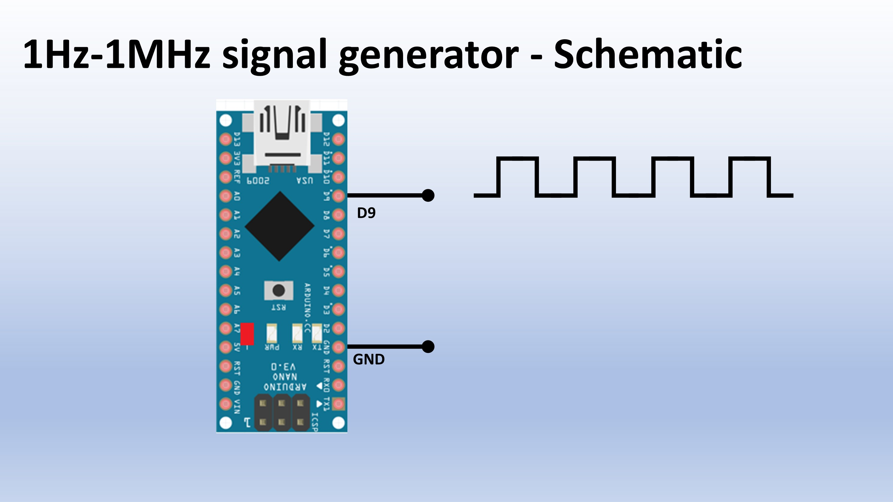

# Description

Build a PWM signal generator from 1Hz to 1MHz with adjustable duty cycle in 5 minutes with an Arduino.
You only need one Arduino, you cen set the frequency and duty cycle via the Serial Monitor.
In the YouTube video I explain and demonstrate the circuit.

# Check out the video:

# Schematic of Arduino PWM signal generator:  
PWM signal from GPIO D9, works with Arduino Nano, Uno.  

# Files:  
  
-Arduino Nano code
